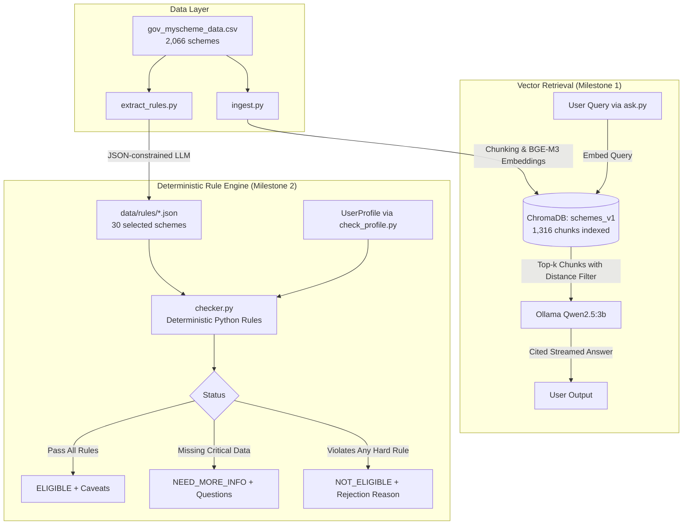

# Comprehensive Technical Analysis Report: EligiBharat

**Date:** October 2026  
**Project:** EligiBharat (Parulverma27/EligiBharat)  
**Workspace:** `d:\Projects\EligiBharat`  
**Core Stack:** Python 3.11+, Ollama (`qwen2.5:3b`, `bge-m3`), ChromaDB, Pydantic, Pandas  

---

## 1. Executive Summary

**EligiBharat** is an open-source, local-first conversational and deterministic AI assistant designed to help Indian citizens identify government welfare schemes they qualify for.

Key architectural characteristics:
1. Embeddings and semantic search run locally using Ollama (`bge-m3`) and ChromaDB.
2. Rule extraction and contextual question answering run locally via Ollama (`qwen2.5:3b`).
3. Eligibility decisions are made by deterministic Python rules, but those rules are extracted by a small local LLM and can be wrong. Extraction accuracy is being measured.

---

## 2. Project Architecture & Workflow

---

## 3. Detailed Milestone Status & Deliverables

### Milestone 1: Baseline Retrieval-Augmented Generation (RAG) — Complete
* **Dataset Ingestion**: `download_data.py` retrieves the official 2,066-scheme dataset from `myscheme.gov.in`.
* **Preprocessing & Chunking**: `utils.py` provides natural-break text splitting (1,000 characters with 150-character overlap) across 7 indexed sections (*Description, Eligibility Criteria, Exclusions, Benefits, Application Process, Documents Required, FAQs*).
* **Vector Store**: `ingest.py` embeds chunks into ChromaDB (`schemes_v1`) with cosine distance indexing. Currently, **1,316 chunks** (including all 30 evaluation schemes) are indexed and ready for retrieval.
* **Retrieval & Guardrails** (`ask.py`):
  * Cosine distance cutoff (`MAX_DISTANCE = 0.55`) automatically discards irrelevant / out-of-domain queries before invoking the LLM.
  * System prompt enforces strict context adherence and source citation (`[1]`, `[2]`).
  * Repetition penalty (`1.15`) and token cap (`500`) prevent runaway Hindi token generation loops.
  * Native Windows UTF-8 stdout reconfiguration handles regional Indian currency symbols (`₹`) and Hindi text without terminal encoding crashes.

---

### Milestone 2: Rule Extraction & Deterministic Checker — Complete
* **Schema Definition** (`schema.py`):
  * `SchemeRules`: Pydantic V2 schema capturing `min_age`, `max_age`, `max_annual_income_inr`, `genders`, `social_categories` (SC/ST/OBC/General/EWS/Minority), `occupations`, `requires_disability`, `requires_bpl`, `other_conditions`, and `exclusions`.
  * `UserProfile`: Structured demographic profile of a citizen (`age`, `annual_income_inr`, `gender`, `state`, `categories`, `occupation`, `is_disabled`, `is_bpl`).
* **Structured Rule Extraction** (`extract_rules.py`):
  * Utilizes Ollama's schema-constrained decoding (`format=SchemeRules.model_json_schema()`) to reliably produce valid JSON.
  * Operates on the 30 representative schemes listed in `eval_schemes.txt` (spanning old-age pensions, student scholarships, farmer income support, and women welfare programs).
  * State scope is deterministically populated from dataset metadata (`State / UT / Ministry`), avoiding LLM geographic misattributions.
  * Extracted JSON files are stored in `data/rules/` and preserved in `data/rules_v1/`.
* **Deterministic Rule Checker** (`checker.py`):
  * Eligibility decisions are made by deterministic Python rules, but those rules are extracted by a small local LLM and can be wrong. Extraction accuracy is being measured.
  * 3-state output:
    1. `eligible`: Meets all stated constraints; lists un-evaluable conditions as `caveats`.
    2. `not_eligible`: Fails at least one explicit restriction (short-circuits over missing information).
    3. `need_more_info`: Does not violate known rules, but lacks required profile facts.
  * Includes semantic synonym mapping for occupational titles (e.g. `cultivator`, `kisan`, `landholder` → `farmer`).
* **Verification & Testing**:
  * `tests/test_checker.py`: **8 automated test suites passing 100%**.
  * `review_rules.py`: Exports `data/rules_review.csv` (30 rows) pairing original source text with LLM extracted JSON for human auditing.
  * `check_profile.py`: Interactive CLI to test individual schemes (`--slug apy`) or batch test across all extracted rules (`--all`).

---

## 4. File-by-File Catalog

| Path | Lines | Purpose & State |
|---|---|---|
| [README.md](file:///d:/Projects/EligiBharat/README.md) | 65 | Root project documentation, installation steps, credits, and disclaimers. |
| [.gitignore](file:///d:/Projects/EligiBharat/.gitignore) | 33 | Ignores `.venv`, `__pycache__`, raw CSV, and local databases. |
| [scheme-agent/config.py](file:///d:/Projects/EligiBharat/scheme-agent/config.py) | 61 | Centralized hyperparameters, model identifiers, chunk limits, and directory paths. |
| [scheme-agent/requirements.txt](file:///d:/Projects/EligiBharat/scheme-agent/requirements.txt) | 5 | Dependencies (`pandas`, `chromadb`, `ollama`, `tqdm`). |
| [scheme-agent/download_data.py](file:///d:/Projects/EligiBharat/scheme-agent/download_data.py) | 12 | Downloads the 16 MB CSV dataset into `data/raw/`. |
| [scheme-agent/utils.py](file:///d:/Projects/EligiBharat/scheme-agent/utils.py) | 49 | Data cleaning, boundary-preserving chunker, and Ollama embedding utility. |
| [scheme-agent/ingest.py](file:///d:/Projects/EligiBharat/scheme-agent/ingest.py) | 78 | Embeds and ingests dataset text into ChromaDB collection `schemes_v1`. |
| [scheme-agent/ask.py](file:///d:/Projects/EligiBharat/scheme-agent/ask.py) | 104 | Interactive and CLI RAG engine with distance cutoff and cited streaming output. |
| [scheme-agent/schema.py](file:///d:/Projects/EligiBharat/scheme-agent/schema.py) | 44 | Pydantic V2 data structures: `SchemeRules` and `UserProfile`. |
| [scheme-agent/extract_rules.py](file:///d:/Projects/EligiBharat/scheme-agent/extract_rules.py) | 121 | LLM structured rule extractor outputting JSON schema files. |
| [scheme-agent/eval_schemes.txt](file:///d:/Projects/EligiBharat/scheme-agent/eval_schemes.txt) | 37 | Slugs for 30 evaluation schemes (pensions, scholarships, farming, etc.). |
| [scheme-agent/checker.py](file:///d:/Projects/EligiBharat/scheme-agent/checker.py) | 145 | Deterministic rule checking engine with occupational synonym mapping. |
| [scheme-agent/check_profile.py](file:///d:/Projects/EligiBharat/scheme-agent/check_profile.py) | 69 | Profile evaluation CLI tool supporting single and batch evaluations. |
| [scheme-agent/review_rules.py](file:///d:/Projects/EligiBharat/scheme-agent/review_rules.py) | 36 | Generates `rules_review.csv` for human annotation of rule accuracy. |
| [scheme-agent/tests/test_checker.py](file:///d:/Projects/EligiBharat/scheme-agent/tests/test_checker.py) | 70 | Unit test suite verifying boundary conditions, failure precedence, and state scopes. |
| [scheme-agent/README_M2.md](file:///d:/Projects/EligiBharat/scheme-agent/README_M2.md) | 28 | Milestone 2 documentation, run order, and tool descriptions. |

---

## 5. Current Test & Operational Status

1. **Automated Tests**:
   - `python tests/test_checker.py`: **8/8 PASSED**.
2. **Database & Rule Corpus**:
   - `data/chroma/`: Vector index populated with **1,316 chunks** (including all 30 evaluation schemes).
   - `data/rules/`: **30/30 scheme rules extracted** as validated JSON files.
   - `data/rules_review.csv`: Generated with all 30 schemes ready for human evaluation.
3. **CLI Execution**:
   - Single-scheme verification (`python check_profile.py --slug apy ...`): Verified working.
   - Batch screening (`python check_profile.py --all ...`): Verified working (e.g., screening 30 schemes returned 3 eligible, 8 need-more-info, 19 not-eligible for a test profile).

---

## 6. Known Limitations & Roadmap for Next Milestones

1. **Rule Extraction Accuracy Audit**:
   - `data/rules_review.csv` has 30 rows generated, but human verification columns (`extraction_correct`, `notes`) are currently empty (0/30 annotated).
   - The LLM can occasionally misinterpret complex clauses (e.g. treating discretionary qualifications as hard exclusions or missing implicit education stage constraints).
2. **Conversational Multi-Turn Agent (Milestone 3)**:
   - Currently, users provide input flags via CLI (`--age`, `--income`, `--state`).
   - The next phase requires an intelligent conversational agent that identifies `missing` fields from `need_more_info` responses and asks clarifying questions in natural conversation (in English, Hindi, etc.).
3. **Full Dataset Scale-Up**:
   - The vector DB currently indexes 100 sample schemes plus the 30 evaluation schemes out of the 2,066 available.
   - Running `ingest.py --all` will scale coverage across all 2,066 schemes.
